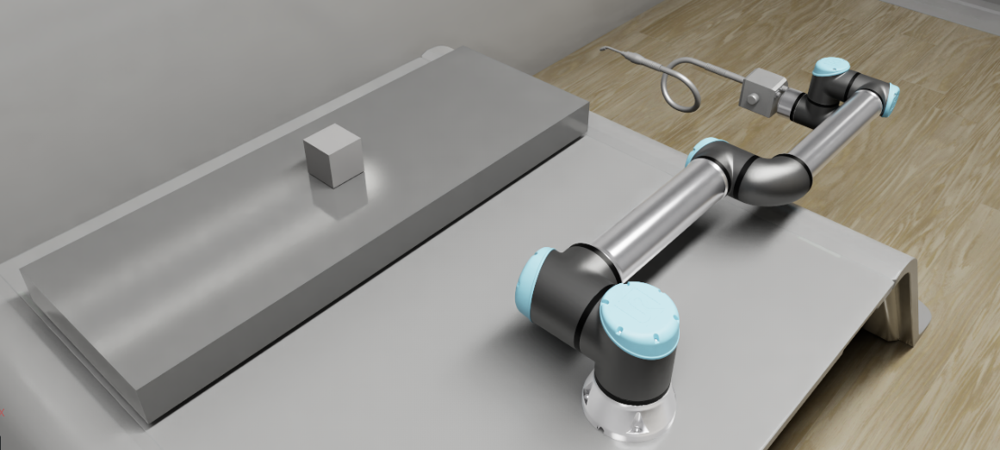

# UR10e Seam Welding with Isaac Sim, MoveIt 2, and ROS 2



This repository contains a ROS 2 and Isaac Sim workflow for simulated seam
tracking with a Universal Robots UR10e. MoveIt 2 plans the robot motion,
Isaac Sim provides the simulated robot, workpiece, and camera data, and OpenCV
detects seam-like edges before the robot follows them with Cartesian motion.

> **Simulation only:** this project does not command a physical welding torch
> and does not implement welding power, wire-feed, shielding-gas, or safety
> controls. Validate the complete cell and all safety interlocks before
> adapting it to hardware.

## Features

- UR10e robot model and MoveIt 2 configuration.
- Isaac Sim standalone scene and seam-tracking script.
- Configurable workpieces: `cube`, `box`, `l_shape`, and `triangle_prism`.
- Eye-in-hand RGB-D camera pipeline.
- OpenCV line detection with depth-based 3D projection.
- MoveIt OMPL approach planning followed by dense Cartesian seam traversal.
- RViz visualization, seam markers, scan phases, and active-edge status.

## System architecture

```text
Isaac Sim
  ├── UR10e articulation and workpiece
  ├── eye-in-hand RGB-D camera
  └── ROS 2 topics: /rgb, /depth, /camera_info, /joint_states
          │
          ▼
moveit_ur10/seam_weld_detector.py
  └── publishes /seam_edges (geometry_msgs/PoseArray)
          │
          ▼
moveit_ur10/seam_weld_supervisor.py
  ├── MoveGroup action: OMPL approach
  ├── GetCartesianPath: seam traversal
  └── FollowJointTrajectory: controller execution
```

## Eye-in-hand camera configuration

The detector is configured for a camera mounted on the UR10e wrist/tool:

| Setting | Value |
| --- | --- |
| Camera mounting | Eye-in-hand, attached to the robot end effector |
| End-effector link | `tool0` |
| Camera TF frame | `ZED_X` |
| RGB input | `/rgb` (`sensor_msgs/msg/Image`) |
| Depth input | `/depth` (`sensor_msgs/msg/Image`) |
| Calibration input | `/camera_info` (`sensor_msgs/msg/CameraInfo`) |
| Robot/world frame | `base_link` |
| Seam output | `/seam_edges` (`geometry_msgs/msg/PoseArray`) |

Isaac Sim must publish the camera topics and a TF chain from `base_link` to
`ZED_X` before starting the detector. The depth image is expected to contain
metric depth in metres. If your camera uses different topic or frame names,
update the constants and subscriptions in
[`seam_weld_detector.py`](src/moveit_ur10/scripts/seam_weld_detector.py), and
ensure the corresponding TF exists.

## Requirements

The project is intended for:

- Ubuntu 22.04
- ROS 2 Humble
- Isaac Sim 5.x (the standalone script currently references Isaac Sim 5.0)
- MoveIt 2
- Python 3.10
- OpenCV, NumPy, SciPy, `cv_bridge`, and `image_geometry`

The exact Isaac Sim installation path is machine-specific. Update the paths
near the top of
[`seam_tracker_isaacsim.py`](src/moveit_ur10/seam_tracker_isaacsim.py) before
running it on another machine.

## Repository layout

```text
.
├── README.md
├── Seam_welding1.usd                 # Isaac Sim scene
├── docs/images/seam-welding-ur10e.png
└── src/
    ├── moveit_ur10/                  # Project package
    │   ├── config/                   # URDF/Xacro, SRDF, controllers, RViz
    │   ├── launch/                  # ROS 2 launch files
    │   ├── scripts/                 # Detection and motion nodes
    │   └── seam_tracker_isaacsim.py # Isaac Sim standalone example
    ├── moveit2/                     # MoveIt 2 source
    ├── trac_ik/                     # TRAC-IK source
    └── ur10e_description/           # UR10e description package
```

Generated `build/`, `install/`, and `log/` directories are local workspace
artifacts and should not be committed to a public repository.

## Build

From the workspace root:

```bash
source /opt/ros/humble/setup.bash
rosdep update
rosdep install --from-paths src --ignore-src -r -y
colcon build --symlink-install
source install/setup.bash
```

If MoveIt 2 or TRAC-IK is maintained in a separate workspace, source that
workspace before building `moveit_ur10`.

## Run the Isaac Sim example

The standalone script creates a UR10e seam-tracking demonstration and accepts
several workpiece shapes:

```bash
/path/to/isaac-sim/python.sh src/moveit_ur10/seam_tracker_isaacsim.py \
  --shape box
```

Available options include:

```text
--shape {cube,box,l_shape,triangle_prism}
--size SIZE       Workpiece size in metres (default: 0.30)
--height HEIGHT   Tool offset above the seam (default: 0.05)
--density N       Waypoints per edge (default: 12)
--speed N         Frames held per waypoint (default: 4)
--headless
```

For the ROS 2 detector/supervisor pipeline, Isaac Sim must additionally
publish `/rgb`, `/depth`, `/camera_info`, `/joint_states`, and the TF chain
described above.

## Run the ROS 2 seam-welding pipeline

With Isaac Sim running and its ROS 2 bridge active:

```bash
source /opt/ros/humble/setup.bash
source install/setup.bash
ros2 launch moveit_ur10 seam_welding.launch.py
```

The launch file starts:

1. `robot_state_publisher`
2. the MoveIt 2 `move_group` node
3. `ros2_control_node`, `joint_state_broadcaster`, and `arm_controller`
4. RViz with the project configuration
5. `seam_weld_detector.py`
6. `seam_weld_supervisor.py`

The supervisor moves to an overview pose, triggers seam detection, approaches
each detected edge, follows it using a Cartesian path, and returns to the home
pose. Useful status topics are `/scan_phase`, `/active_seam_index`, and
`/seam_markers`.

To run the older tracker pipeline instead:

```bash
ros2 launch moveit_ur10 seam_tracker.launch.py
```

## Camera and topic checks

Before launching the pipeline, verify the camera bridge:

```bash
ros2 topic list | grep -E '(/rgb|/depth|/camera_info|/joint_states)'
ros2 topic echo /camera_info --once
ros2 run tf2_ros tf2_echo base_link ZED_X
```

If the detector reports that RGB, depth, calibration, or TF data is missing,
fix the Isaac Sim bridge or frame names before changing motion-planning
parameters.

## Configuration

The most relevant files are:

- [`seam_welding.launch.py`](src/moveit_ur10/launch/seam_welding.launch.py):
  complete ROS 2 bringup and node parameters.
- [`seam_weld_detector.py`](src/moveit_ur10/scripts/seam_weld_detector.py):
  camera subscriptions, Canny/Hough settings, depth projection, and overlays.
- [`seam_weld_supervisor.py`](src/moveit_ur10/scripts/seam_weld_supervisor.py):
  approach, Cartesian traversal, tool offset, and controller execution.
- [`seam_tracker_isaacsim.py`](src/moveit_ur10/seam_tracker_isaacsim.py):
  Isaac Sim shapes, placement, and waypoint generation.
- [`config/ros2_controllers.yaml`](src/moveit_ur10/config/ros2_controllers.yaml):
  UR10e joint trajectory controller interfaces.
- [`config/ur10e_robot.urdf.xacro`](src/moveit_ur10/config/ur10e_robot.urdf.xacro):
  robot and tool/camera model configuration.

## Limitations and next steps

- The current detector identifies geometric image edges; it is not a
  production weld-seam classifier.
- Camera calibration, latency, synchronization, and occlusion handling should
  be validated for the intended cell.
- The simulated controller and tool offset are not a substitute for robot,
  torch, fixture, or process calibration.
- Add collision geometry, speed limits, process I/O, and hardware-specific
  drivers before any physical deployment.

## License

The custom project code is currently packaged as BSD in `package.xml`. Review
and update the repository license and third-party notices before publishing,
especially if committing the bundled MoveIt 2, TRAC-IK, robot-description, or
USD assets.
